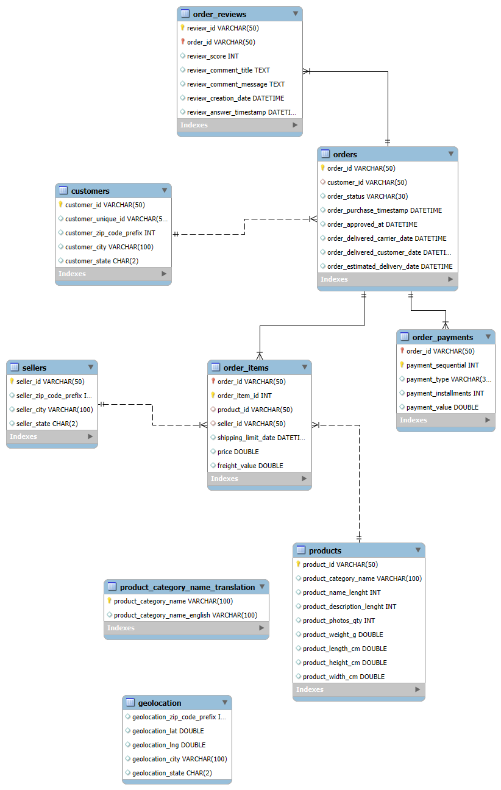

# AURIXA — E-Commerce Data Engineering Pipeline

AURIXA is an e-commerce data engineering portfolio project built using the Olist Brazilian E-Commerce Public Dataset. The project focuses on preparing raw data, performing data cleaning and transformation, validating data quality, and loading structured datasets into a MySQL database for analytical use.

## Project Overview

The pipeline processes nine related e-commerce datasets and organizes them into a structured database. It includes data profiling, cleaning, transformation, schema validation, relationship checks, database loading, and row-count verification.

**Key Objectives**
- Build a structured ETL workflow.
- Improve data quality through cleaning and validation.
- Organize related datasets in a relational database.
- Validate primary keys and dataset relationships.
- Prepare reliable data for SQL analytics and reporting.

## Technology Stack

- **Python** — ETL development and automation
- **Pandas** — Data cleaning, transformation, and validation
- **SQL** — Data querying and database validation
- **MySQL** — Relational database storage
- **SQLAlchemy** — Python-to-MySQL connectivity
- **Git & GitHub** — Version control and project documentation
- **VS Code** — Development environment
- **MySQL Workbench** — Database management and ER diagram

## ETL Workflow

1. **Extract:** Read the prepared Olist CSV datasets.
2. **Transform:** Clean and standardize data, handle duplicates and missing values, and prepare datasets for database storage.
3. **Validate:** Check schemas, primary keys, date fields, and relationships between datasets.
4. **Load:** Load structured datasets into the `aurixa_db` MySQL database using the Python ETL module.
5. **Verify:** Compare expected dataset row counts with database table counts.

## Dataset Information

The project uses nine cleaned datasets:

| Dataset | Rows |
|---|---:|
| Customers | 99,441 |
| Geolocation | 738,332 |
| Orders | 99,441 |
| Order Items | 112,650 |
| Order Payments | 103,886 |
| Order Reviews | 99,224 |
| Products | 32,951 |
| Sellers | 3,095 |
| Product Category Translation | 71 |

**Total:** 1,322,091 rows across nine datasets.

## Database Design

The MySQL database is named `aurixa_db` and contains nine tables corresponding to the cleaned datasets.

Key relationships validated in the ETL workflow include:

- Orders → Customers
- Order Items → Orders
- Order Items → Products
- Order Items → Sellers
- Order Payments → Orders
- Order Reviews → Orders

The product category translation dataset is maintained separately. Geolocation data is also stored separately because its relationship with other datasets requires appropriate key mapping.

## Project Diagrams

### Entity Relationship Diagram (ERD)

The ERD illustrates the database tables and their relationships.



### Data Flow Diagram

The data flow diagram illustrates the pipeline from raw datasets through cleaning and validation to MySQL and SQL analytics.


## Data Quality and Validation

The project includes checks for:

- Expected columns and schema consistency
- Primary-key uniqueness
- Missing and invalid values
- Date-field consistency
- Duplicate records
- Negative prices and freight values
- Dataset relationship integrity
- Database connection and row-count verification
- ETL logging and error capture

## Testing

The following checks have been performed:

- Python syntax compilation for the ETL loader
- MySQL connection test
- Source dataset and relationship validation
- Logging and error-capture test
- Database row-count verification for all nine tables

The source validation tests passed, and the existing MySQL table counts matched the expected dataset counts.

## Project Structure

```text
AURIXA/
├── data/
│   ├── RAW/
│   └── cleaned/
├── cleaning/
├── etl/
│   ├── load.py
│   ├── test_connection.py
│   ├── test_validation.py
│   └── test_logging.py
├── Reports/
│   ├── etl_load.log
│   ├── AURIXA_ER_Diagram.png
│   └── AURIXA_Data_Flow_Diagram.png
├── .venv/
└── README.md
```

*Note: The structure above summarizes the main project components.*

## Running the Validation Tests

Run the commands below from the AURIXA project directory in PowerShell.

**1. Test the MySQL connection**

```powershell
.\.venv\Scripts\python.exe etl/test_connection.py
```

**2. Validate the cleaned datasets and relationships**

```powershell
.\.venv\Scripts\python.exe etl/test_validation.py
```

**3. Test logging and error capture**

```powershell
.\.venv\Scripts\python.exe etl/test_logging.py
```

The database password should be supplied through the `AURIXA_DB_PASSWORD` environment variable. Never commit credentials or private configuration files to GitHub.

## Future Improvements

- Extend analytical SQL queries and reporting.
- Introduce PySpark for distributed data processing.
- Explore AWS data services for cloud-based storage and processing.
- Add further automated data quality and integration tests.

## Project Status

The nine cleaned datasets have been validated, loaded into MySQL, and checked against expected table row counts. Database connectivity, source validation, and logging tests have also been performed.

**AURIXA** demonstrates practical data engineering concepts, including ETL development, relational database design, data quality validation, and analytical data preparation.